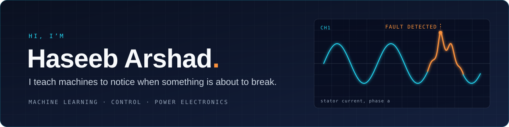
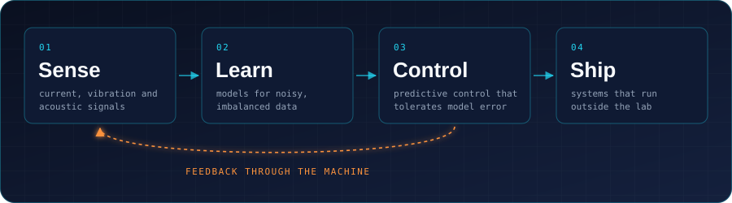

<p align="center">
  <picture>
    <source media="(prefers-color-scheme: dark)" srcset="https://readme-typing-svg.demolab.com/?font=Fira+Code&size=21&duration=3200&pause=1100&color=22D3EE&center=true&vCenter=true&width=700&height=44&lines=Finding+faults+in+electric+drives+before+they+spread;Predictive+control+that+holds+up+when+the+model+is+wrong;RAG+systems+that+check+their+own+citations;Transformers+written+from+scratch%2C+running+in+the+browser">
    
  </picture>
</p>

<p align="center">
  <a href="https://haseeb-arshad.me"></a>
  <a href="https://www.linkedin.com/in/haseeb-arshad-ee"></a>
  <a href="https://scholar.google.com/citations?hl=en&user=-nga1p4AAAAJ"></a>
  <a href="mailto:haseeb.arshad.ee@gmail.com"></a>
</p>

```python
class Haseeb:
    role    = "PhD Candidate, Electrical & Computer Engineering"
    where   = "University of Alberta · Edmonton, Canada"
    focus   = "machine learning for machines that can't afford to fail"
    open_to = ["research & applied ML roles", "postdoctoral positions"]

    def say_hi(self):
        return "haseeb.arshad.ee@gmail.com"
```

I work where machine learning meets hardware: catching faults in electric motors
from the signals they give off, and building ML systems that keep working outside
the lab. I measure what works, and I like shipping things people can try.

### How I work



| | What I do | Tools |
|---|---|---|
| **Sense** | Read current, vibration and acoustic signals from motors and converters, on hardware-in-the-loop benches |  `dSPACE` `RTDS` `Imperix B-Box` |
| **Learn** | Feature engineering, stacking ensembles and deep models that hold up under class imbalance; transformers written from primitives |  |
| **Control** | Finite-control-set MPC, predictive torque control and sliding mode, with cost weights tuned by NSGA-II and TOPSIS |  `Simulink` |
| **Ship** | APIs, vector search and in-browser inference that other people can use |  `ONNX` |

### What I've built

**[myScholarRAG](https://github.com/hasyarshad/myscholarRAG)** · [live demo](https://haseeb-arshad.me/myscholar)<br>
A research assistant over my papers that checks every citation in code before it
answers. Nine measured configurations took unsupported claims from 51% to 8%.<br>
`FastAPI` `Postgres + pgvector` `ONNX Runtime` `Cloud Run`

**[English ↔ Roman Urdu translator](https://github.com/hasyarshad/roman-urdu-translator)** · [try it](https://haseeb-arshad.me/translator)<br>
An 81M-parameter transformer written from scratch in PyTorch, trained on a
1.81M-pair corpus I built, and running entirely in your browser. 23.2 / 30.7 BLEU.<br>
`PyTorch` `ONNX` `onnxruntime-web`

**Diabetic retinopathy screening** · in progress<br>
One model grades retinal scans and a locally run LLM explains the result in plain
language. Nothing leaves our own hardware.<br>
`PyTorch` `Ollama` `React Native`

### Research

20 papers, 266+ citations and an h-index of 8 on
[Google Scholar](https://scholar.google.com/citations?hl=en&user=-nga1p4AAAAJ).
My PhD is about finding faults in electric drives before they spread, and control
that keeps working when the plant model is wrong. I also contribute to ORION, a
Horizon Europe project on renewable energy integration in Alberta.

### Outside the lab

President of the University of Alberta Graduate Students' Association (2024–25).
We secured $8.55M in support for graduate students and published *Under Pressure*,
the university's first graduate mental health report.

### Let's work together

I'm interested in fault diagnosis and condition monitoring, machine learning for
power systems and power electronics, and AI systems that have to be right. Reach
me at [haseeb.arshad.ee@gmail.com](mailto:haseeb.arshad.ee@gmail.com) or on
[LinkedIn](https://www.linkedin.com/in/haseeb-arshad-ee).
