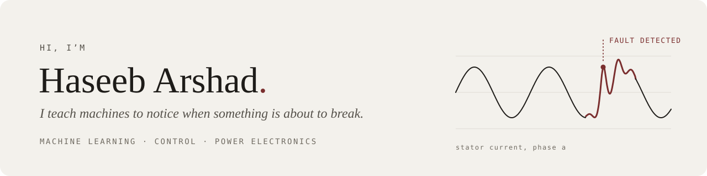
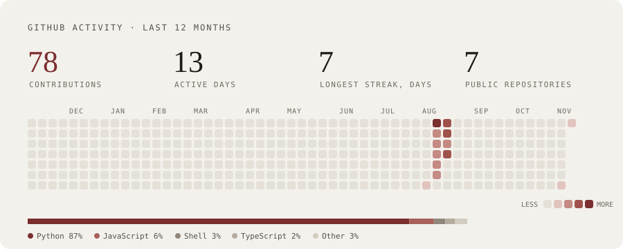

<picture>
  <source media="(prefers-color-scheme: dark)" srcset="assets/banner-dark.svg">
  
</picture>

<p align="center">
  <a href="https://haseeb-arshad.me"></a>
  <a href="https://www.linkedin.com/in/haseeb-arshad-ee"></a>
  <a href="https://scholar.google.com/citations?hl=en&user=-nga1p4AAAAJ"></a>
  <a href="mailto:haseeb.arshad.ee@gmail.com"></a>
</p>

```python
class Haseeb:
    role     = "PhD Candidate, Electrical & Computer Engineering"
    where    = "University of Alberta · Edmonton, Canada"

    works_on = ["fault diagnosis for electric drives",
                "predictive control of power electronics",
                "anomaly detection on noisy, imbalanced sensor data"]

    stack = {
        "ml":      ["PyTorch", "TensorFlow", "ONNX", "Hugging Face"],
        "systems": ["FastAPI", "Postgres + pgvector", "Docker", "Cloud Run"],
        "web":     ["TypeScript", "Next.js", "onnxruntime-web"],
        "control": ["MATLAB/Simulink", "dSPACE", "RTDS", "Imperix"],
    }

    open_to = ["research & applied ML roles", "postdoctoral positions"]

    def say_hi(self):
        return "haseeb.arshad.ee@gmail.com"
```

I work where machine learning meets hardware: catching faults in electric motors
from the signals they give off, and building ML systems that keep working outside
the lab. I measure what works, and I like shipping things people can try.

### What I've built

**[myScholarRAG](https://github.com/hasyarshad/myscholarRAG)** · [live demo](https://haseeb-arshad.me/myscholar)<br>
A research assistant over my papers that checks every citation in code before it
answers. Nine measured configurations took unsupported claims from 51% to 8%.<br>
`FastAPI` `Postgres + pgvector` `ONNX Runtime` `Cloud Run`

**[English ↔ Roman Urdu translator](https://github.com/hasyarshad/roman-urdu-translator)** · [try it](https://haseeb-arshad.me/translator)<br>
An 81M-parameter transformer written from scratch in PyTorch, trained on a
1.81M-pair corpus I built, and running entirely in your browser. 23.2 / 30.7 BLEU.<br>
`PyTorch` `ONNX` `onnxruntime-web`

**Diabetic retinopathy screening** · in progress<br>
One model grades retinal scans and a locally run LLM explains the result in plain
language. Nothing leaves our own hardware.<br>
`PyTorch` `Ollama` `React Native`

### Activity

<picture>
  <source media="(prefers-color-scheme: dark)" srcset="assets/activity-dark.svg">
  
</picture>

### Research

20 papers, 266+ citations and an h-index of 8 on
[Google Scholar](https://scholar.google.com/citations?hl=en&user=-nga1p4AAAAJ).
My PhD is about finding faults in electric drives before they spread, and control
that keeps working when the plant model is wrong. I also contribute to ORION, a
Horizon Europe project on renewable energy integration in Alberta.

### Outside the lab

President of the University of Alberta Graduate Students' Association (2024–25).
We secured $8.55M in support for graduate students and published *Under Pressure*,
the university's first graduate mental health report.
