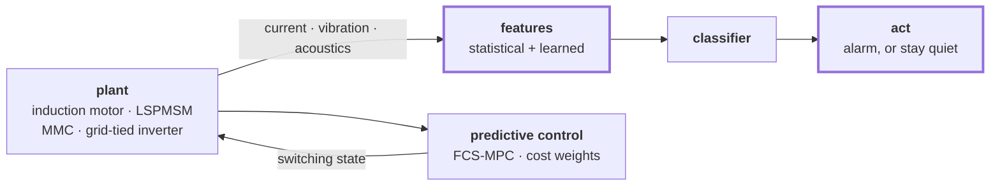

# Muhammad Haseeb Arshad

**PhD Candidate, Electrical & Computer Engineering, University of Alberta**
Advanced Control Systems & Diagnosis Lab, under Prof. Qing Zhao

I work on electric drives. Finding **faults** before they spread, and keeping
control when the model is wrong.

[haseeb-arshad.me](https://haseeb-arshad.me) ·
[Scholar](https://scholar.google.com/citations?hl=en&user=-nga1p4AAAAJ) ·
[LinkedIn](https://www.linkedin.com/in/haseeb-arshad-ee) ·
[marshad4@ualberta.ca](mailto:marshad4@ualberta.ca)

---

## The problem, as a block diagram

Two loops around the same machine. One reads it, one drives it.

Most fault-detection papers report accuracy on clean benchmarks. Real
industrial data is imbalanced, noisy, and arrives from several sensors at once
with no common clock. Two consequences shape everything I do:

- **The classifier is rarely the hard part.** The work is in the feature
  engineering that makes a fault separable when all you have is a current
  signature or an acoustic trace.
- **On a plant floor, a false alarm often costs more than a missed fault.**
  That inverts the objective you would pick by default.

## What I work on

| Thread | The question |
|---|---|
| **Fault diagnosis for machines and drives** | Stator winding inter-turn faults, rotor imbalance, bearing degradation. What makes a fault separable? |
| **Predictive and adaptive control of power electronics** | How do you tune a cost function when its terms have no common unit? |
| **Adversarial robustness without the accuracy tax** | Robustness usually costs clean accuracy. Is that a fixed price or a constraint you can schedule? |
| **Time-series anomaly detection under imbalance** | Faults are rare by definition, so the training distribution misleads you. |

## Selected work

**20 publications · 241 citations · h-index 8 · i10-index 7** (2018–2026)

| | Venue | Cited |
|---|---|--:|
| [Weighting factors optimization of MPTC for induction motors using NSGA-II with TOPSIS](https://doi.org/10.1109/access.2019.2958415) | IEEE Access (Q1), 2019 | 100 |
| [Hierarchical control of a DC motor with Cuk converter: differential flatness and sliding mode](https://doi.org/10.1007/s13369-020-05305-9) | Arabian J. Sci. Eng. (Q1), 2021 | 23 |
| [Packet- and flow-level intrusion detection with reinforcement learning and adversarial training](https://doi.org/10.3390/a15120453) | Algorithms (Q2), 2022 | 21 |
| Implications of sensorless predictive control for line-start PMSMs | IEEE T-ASE (Q1), 2023 | 10 |
| Rotor imbalance classification through unified feature fusion | Eng. Appl. Artif. Intell. (Q1), 2025 | 8 |
| Meta-learner stacking for stator winding inter-turn fault detection in LSPMSMs | IEEE JESTIE (Q1), 2026 | new |

Full list, with abstracts and apparatus photographs, at
[haseeb-arshad.me/research](https://haseeb-arshad.me/research).

## Built, not only published

**[English ↔ Roman Urdu translation](https://haseeb-arshad.me/translator)**, an
81M-parameter encoder-decoder written from primitives in PyTorch. No
`nn.Transformer`, no `AutoModel`, no training framework.

The harder half was the data: no public English to Roman Urdu parallel corpus
existed, so I built one of 1.81M sentence pairs. Both languages share a 24k
byte-level BPE vocabulary, because Roman Urdu is written in Latin script, and a
leading tag tells one set of weights which direction to emit.

It runs **in your browser**. Exported to ONNX, quantised to int8, decoded by
`onnxruntime-web`. There is no server, so nothing you type leaves the tab.
Getting it there meant proving the port was faithful rather than assuming it:

| Check | Result |
|---|--:|
| ONNX vs PyTorch, forward pass | ~1e-5 max abs difference |
| Greedy decode, fp32 and int8 | 10/10 output strings identical |
| JS tokenizer vs Rust `tokenizers` | 2033/2033 encode and decode |
| BLEU on held-out Tatoeba | 23.2 en→ur · 30.7 ur→en |

[Code](https://github.com/hasyarshad/roman-urdu-translator) ·
[Weights](https://huggingface.co/hasyarshad/roman-urdu-translator)

## Outside the lab

President of the Graduate Students' Association at the University of Alberta
(2024–2025), and Vice President Student Services the year before. Sat on the
Board of Governors, and represented the university at CASA in Ottawa as lead
author of its policy paper on generative AI in Canadian post-secondary
education.

**$8.55M** secured in graduate student financial support over the term, and
*Under Pressure*, the first comprehensive mental health report for graduate
students at this university.

## Currently

**Open to postdoctoral positions** in fault diagnosis, predictive control, and
machine learning for power systems. Also contributing diagnosis and control work
to **ORION**, a Horizon Europe project on integrating renewable generation into
the Alberta grid.

The best way to reach me is [email](mailto:marshad4@ualberta.ca).
