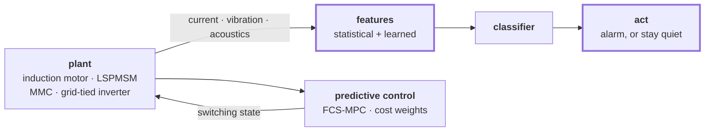

<h1>Muhammad Haseeb Arshad</h1>

**Optimal control for power drives, and machine learning for the signals they give off.**

PhD Candidate, Electrical & Computer Engineering, University of Alberta 
Advanced Control Systems & Diagnosis Lab

[**haseeb-arshad.me**](https://haseeb-arshad.me) · [Scholar](https://scholar.google.com/citations?hl=en&user=-nga1p4AAAAJ) · [LinkedIn](https://www.linkedin.com/in/haseeb-arshad-ee) · [marshad4@ualberta.ca](mailto:marshad4@ualberta.ca)

`20 papers` · `241 citations` · `h-index 8` · `i10-index 7` · **open to postdoc and research roles**

---

## Stack

| | |
|---|---|
| **Control** | Finite-control-set MPC · model predictive torque control · field-oriented control · sliding mode (adaptive discrete-time, hierarchical) · backstepping · differential flatness · MRAS observers · LQG |
| **Machine learning** | PyTorch · TensorFlow · transformers · 1D CNNs · LSTMs and learnable filter banks · stacking ensembles and gradient-boosted meta-learners · liquid neural networks |
| **Time series & signals** | Statistical feature engineering and fusion · acoustic fault signatures · SINDy · multi-modal sensor synchronisation · class balancing for rare faults · physics-informed constraints · adaptive focal loss |
| **Optimisation** | NSGA-II · MOPSO · genetic algorithms · artificial bee colony · TOPSIS · primal-dual formulations · convex surrogates |
| **Plant** | Induction machines · line-start PMSMs · modular multilevel converters · grid-tied inverters with LCL/LC filters · DC-DC Cuk converters · quadrotor UAVs |
| **Bench** | Hardware-in-the-loop with RTDS and dSPACE · Imperix B-Box real-time control · torque and speed instrumentation · MATLAB/Simulink |
| **Shipping** | ONNX · onnxruntime-web · Ollama · Hugging Face Hub · Weights & Biases · Docker · Git |

Languages: **Python**, **MATLAB**, C/C++, R.

---

## Featured projects

### English ↔ Roman Urdu translation `LIVE`

> **[Try it in your browser](https://haseeb-arshad.me/translator)** · no server, nothing you type leaves the tab

An 81M-parameter encoder-decoder written from primitives in PyTorch. No
`nn.Transformer`, no `AutoModel`, no training framework: multi-head attention,
positional encoding, residual wiring, layer norm and the projection head are all
written out.

The harder half was data. No public English to Roman Urdu parallel corpus
existed, so I built one of **1.81M sentence pairs**. Both languages share a 24k
byte-level BPE vocabulary, because Roman Urdu is written in Latin script, and a
leading tag tells one set of weights which direction to emit.

Then I moved it off the server entirely: exported to ONNX, quantised to int8,
decoded client-side by `onnxruntime-web`. Porting a model is easy to get subtly
wrong, so it is verified rather than assumed.

| Check | Result |
|---|--:|
| ONNX vs PyTorch, forward pass | ~1e-5 max abs difference |
| Greedy decode, fp32 and int8 | 10/10 strings identical |
| JS tokenizer vs Rust `tokenizers` | 2033/2033 encode and decode |
| BLEU, held-out Tatoeba | **23.2** en→ur · **30.7** ur→en |

`PyTorch` `ONNX` `onnxruntime-web` `Hugging Face Hub` 
[Code](https://github.com/hasyarshad/roman-urdu-translator) ·
[Weights](https://huggingface.co/hasyarshad/roman-urdu-translator)

### Diabetic retinopathy: graded by one model, explained by another `IN PROGRESS`

A confidence score is not an answer. Told a scan grades 0.78 for referable
retinopathy, most people cannot tell whether that means book an appointment or
ignore it, and a clinician still has to write the explanation.

So the pipeline has two halves. A deep network reads the image and produces
graded confidences; an LLM served through Ollama, tuned on our own material,
writes the summary that reaches the patient. **Nothing goes to a third-party
API**, which for retinal images is the entire point. An Expo client closes the
loop so it can be tested end to end rather than argued about.

I work the research side: what the classifier trains on, and how far its output
can reasonably be pushed into words. It produces suggestions for follow-up, not
diagnoses.

`PyTorch` `Ollama` `React Native / Expo` · with Ibtidah Solutions

### Retrieval over my own literature `BUILDING`

A local RAG pipeline pointed at the papers I actually read and cite, so I can
ask questions across a corpus instead of grepping a folder of PDFs.

Built on a working local pipeline: sentence-transformer embeddings, nearest
neighbour retrieval, generation through Ollama, all on the machine. The
interesting part of RAG is never the model at the end. It is how documents get
chunked, what the embedding actually indexes, and how badly the answer degrades
when retrieval returns something *almost* relevant. Scholarly PDFs make that
harder: equations, multi-column layout, and figure captions that matter.

`sentence-transformers` `Ollama` `Python`

More at [haseeb-arshad.me/projects](https://haseeb-arshad.me/projects).

---

## The research, as a block diagram

Two loops around the same machine. One reads it, one drives it.

Most fault-detection papers report accuracy on clean benchmarks. Real industrial
data is imbalanced, noisy, and arrives from several sensors at once with no
common clock. Two consequences shape everything I do:

- **The classifier is rarely the hard part.** The work is in the feature
  engineering that makes a fault separable when all you have is a current
  signature or an acoustic trace.
- **On a plant floor, a false alarm often costs more than a missed fault.** That
  inverts the objective you would otherwise pick by default.

The four threads: fault diagnosis for machines and drives · predictive and
adaptive control of power electronics · adversarial robustness without the
accuracy tax · time-series anomaly detection under imbalance.

---

## Selected publications

| | Venue | Cited |
|---|---|--:|
| [Weighting factors optimization of MPTC for induction motors using NSGA-II with TOPSIS](https://doi.org/10.1109/access.2019.2958415) | IEEE Access (Q1), 2019 | 100 |
| [Hierarchical control of a DC motor with Cuk converter: differential flatness and sliding mode](https://doi.org/10.1007/s13369-020-05305-9) | Arabian J. Sci. Eng. (Q1), 2021 | 23 |
| [Packet- and flow-level intrusion detection with reinforcement learning and adversarial training](https://doi.org/10.3390/a15120453) | Algorithms (Q2), 2022 | 21 |
| Implications of sensorless predictive control for line-start PMSMs | IEEE T-ASE (Q1), 2023 | 10 |
| Rotor imbalance classification through unified feature fusion | Eng. Appl. Artif. Intell. (Q1), 2025 | 8 |
| Meta-learner stacking for stator winding inter-turn fault detection in LSPMSMs | IEEE JESTIE (Q1), 2026 | new |

All 20, with abstracts and apparatus photographs, at
[haseeb-arshad.me/research](https://haseeb-arshad.me/research).

---

## Outside the lab

President of the Graduate Students' Association at the University of Alberta
(2024–2025), Vice President Student Services the year before. Sat on the Board of
Governors, and represented the university at CASA in Ottawa as lead author of its
policy paper on generative AI in Canadian post-secondary education.

**$8.55M** secured in graduate student financial support over the term, and
*Under Pressure*, the first comprehensive mental health report for graduate
students at this university.

---

Currently contributing diagnosis and control work to **ORION**, a Horizon Europe
project on integrating renewable generation into the Alberta grid, and **open to
postdoctoral and research positions** in fault diagnosis, predictive control, and
machine learning for power systems.

Reach me at [marshad4@ualberta.ca](mailto:marshad4@ualberta.ca).
